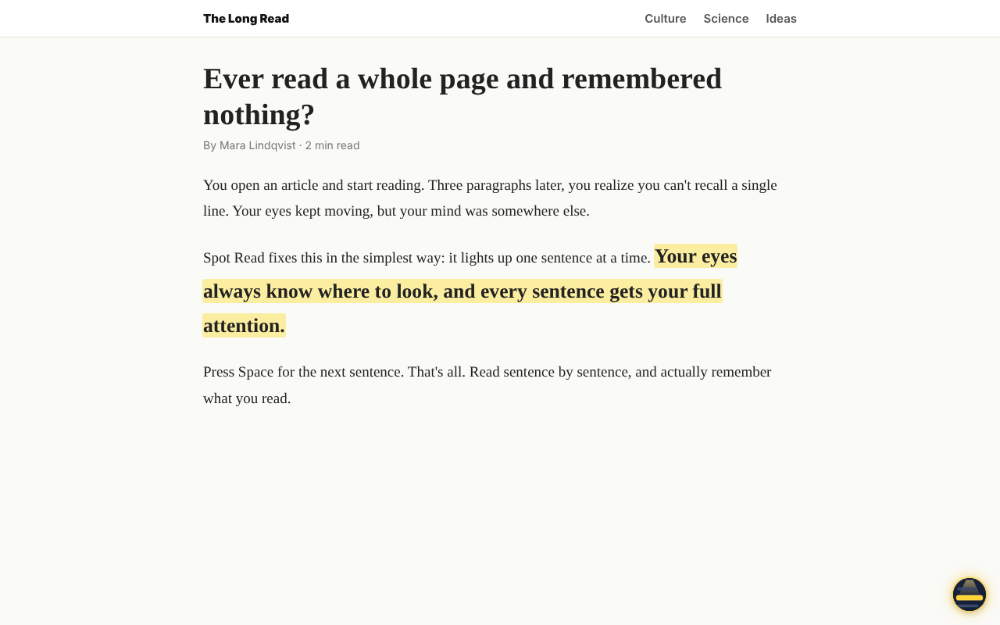
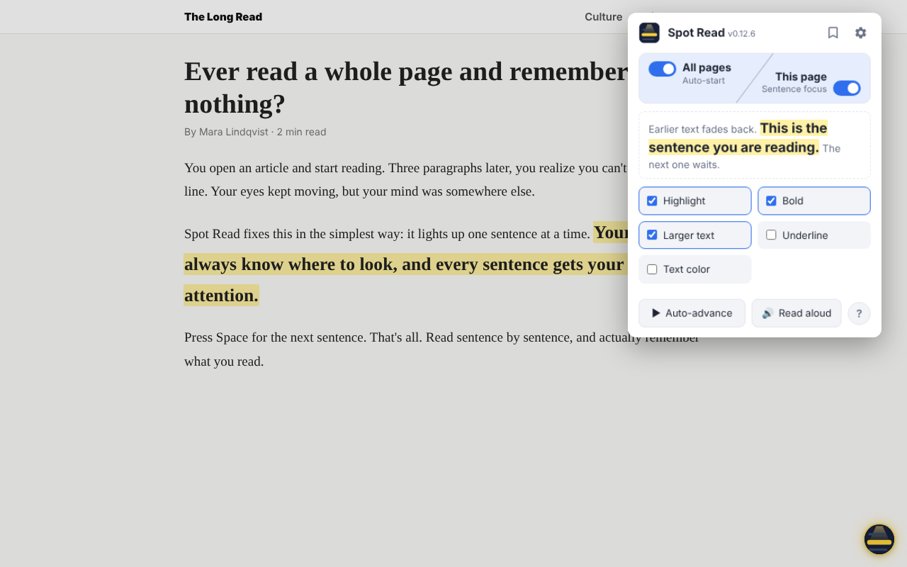
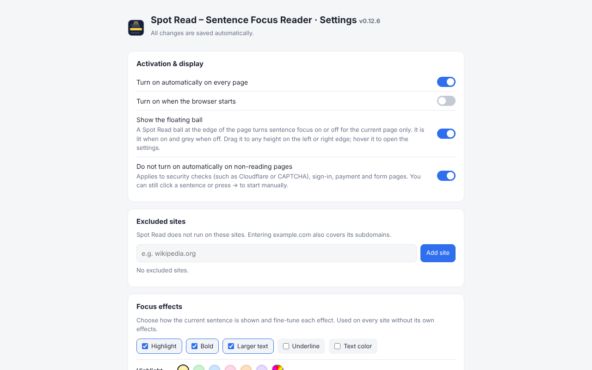

  

<h1 align="center">Spot Read</h1>

  <b>Read one sentence at a time.</b> 
  A browser extension that keeps your focus on the sentence you are reading, for easier reading of long texts.

  <a href="https://chromewebstore.google.com/detail/spot-read-%E2%80%93-sentence-focu/gckmcmnjhcbhmgmdmdellepjjdinaooi"><b>Chrome Web Store</b></a> ·
  <a href="https://github.com/n2ywzt8hegodfiob/spot-read-test/raw/main/downloads/spot-read-v0.12.22.zip">Download test build</a> ·
  <a href="CHANGELOG.md">Changelog</a> ·
  <a href="README.zh-CN.md">中文</a>

  

## Features

- **Sentence focus**: the current sentence is highlighted, bolded, enlarged or underlined, in the style you choose.
- **Simple navigation**: press **Space** or **→** for the next sentence and **←** to go back, or click any sentence.
- **Main content only**: menus, ads, user names and timestamps are skipped, so you read the article itself.
- **Long sentences in parts**: very long sentences can be read part by part.
- **Auto-advance and read-aloud**: move on automatically at your own pace, with optional text-to-speech.
- **Built-in PDF reader**: read PDFs sentence by sentence, from the web or from your computer.
- **Copy and save**: right-click a sentence twice to copy it, three times to save it to your favorites, with optional sync across devices.
- **Works where you read**: news sites, Gmail, Reddit, LinkedIn, AI chat pages and more.

  
  

## Install

**Recommended:** install Spot Read from the [Chrome Web Store](https://chromewebstore.google.com/detail/spot-read-%E2%80%93-sentence-focu/gckmcmnjhcbhmgmdmdellepjjdinaooi). It also works in Microsoft Edge, and it updates automatically.

### Test builds (Chrome / Edge)

This repository hosts test builds, which get new fixes before the store version. It contains no source code.

1. Download the latest build: **[spot-read-v0.12.22.zip](https://github.com/n2ywzt8hegodfiob/spot-read-test/raw/main/downloads/spot-read-v0.12.22.zip)** (older builds are in [downloads](downloads)).
2. Unzip it into a folder you will keep. The browser loads the extension from that folder.
3. Open `chrome://extensions` (Edge: `edge://extensions`) and turn on **Developer mode**.
4. Click **Load unpacked** and choose the unzipped folder (the one that contains `manifest.json`).
5. Pin Spot Read to the toolbar, open an article and press **Space**.

**Update:** replace the files in the same folder with the new build, click the reload button on the Spot Read card in `chrome://extensions`, then refresh open tabs.

**Local PDF files:** on the Spot Read card, click **Details** and turn on **Allow access to file URLs**.

## Changelog

See [CHANGELOG.md](CHANGELOG.md) for what changed in each version.

## Feedback

Questions, bugs and ideas: [assist@getspotread.com](mailto:assist@getspotread.com)
