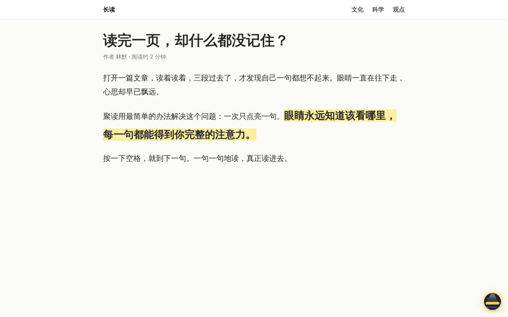
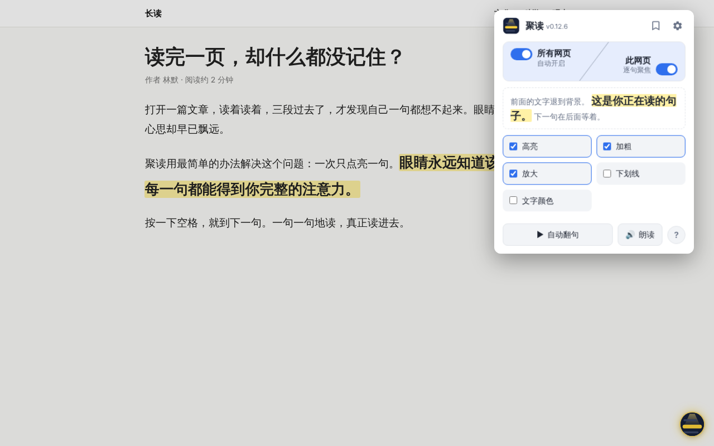
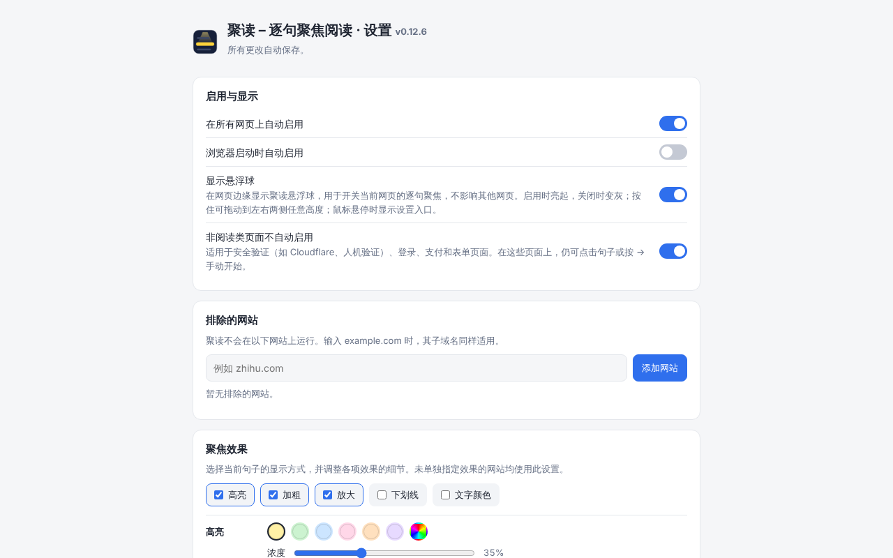

  

<h1 align="center">聚读 Spot Read</h1>

  <b>一次只读一句话。</b> 
  一款浏览器插件，让你的注意力始终停在正在读的那一句上，读长文更轻松。

  <a href="https://chromewebstore.google.com/detail/spot-read-%E2%80%93-sentence-focu/gckmcmnjhcbhmgmdmdellepjjdinaooi"><b>Chrome 应用商店</b></a> ·
  <a href="https://github.com/n2ywzt8hegodfiob/spot-read-test/raw/main/downloads/spot-read-v0.12.23.zip">下载测试版</a> ·
  <a href="CHANGELOG.md">更新记录（英文）</a> ·
  <a href="README.md">English</a>

  

## 功能

- **逐句聚焦**：当前这句话会高亮、加粗、放大或加下划线，样式可以自己选。
- **简单翻句**：按 **空格** 或 **→** 读下一句，**←** 回到上一句，也可以直接点任意一句。
- **只读正文**：自动跳过菜单、广告、用户名和时间，只读文章本身。
- **长句分段**：特别长的句子可以分成几段来读。
- **自动翻句和朗读**：按你的节奏自动往下读，也可以打开朗读。
- **内置 PDF 阅读器**：网上的和电脑里的 PDF 都能逐句阅读。
- **复制和收藏**：在句子上右键点两下复制，点三下收藏，收藏可以在多台设备之间同步。
- **常用网站都能用**：新闻网站、Gmail、Reddit、LinkedIn、AI 对话页面等。

  
  

## 安装

**推荐：** 从 [Chrome 应用商店](https://chromewebstore.google.com/detail/spot-read-%E2%80%93-sentence-focu/gckmcmnjhcbhmgmdmdellepjjdinaooi)安装聚读。Edge 也可以直接从 Chrome 应用商店安装，商店版会自动更新。

### 测试版（Chrome / Edge）

这个仓库放的是测试版安装包，新的修复会比商店版更早出现在这里。仓库里不含源码。

1. 下载最新版：**[spot-read-v0.12.23.zip](https://github.com/n2ywzt8hegodfiob/spot-read-test/raw/main/downloads/spot-read-v0.12.23.zip)**（旧版本在 [downloads](downloads) 文件夹里）。
2. 解压到一个会长期保留的文件夹，浏览器会从这个文件夹加载插件。
3. 打开 `chrome://extensions`（Edge 打开 `edge://extensions`），打开「**开发者模式**」。
4. 点「**加载已解压的扩展程序**」，选择解压后的文件夹（里面有 `manifest.json` 的那一层）。
5. 把聚读固定到工具栏，打开一篇文章，按 **空格** 就能开始逐句读。

**更新：** 用新版文件覆盖同一个文件夹，在 `chrome://extensions` 里点聚读卡片上的刷新按钮，再刷新已打开的网页。

**读本地 PDF：** 在聚读卡片上点「详情」，打开「允许访问文件网址」。

## 更新记录

每个版本的改动见 [CHANGELOG.md](CHANGELOG.md)（英文）。

## 许可

聚读可以免费使用，但不开源，保留所有权利。详见 [LICENSE](LICENSE)。

## 反馈

问题、bug 和建议：[assist@getspotread.com](mailto:assist@getspotread.com)
